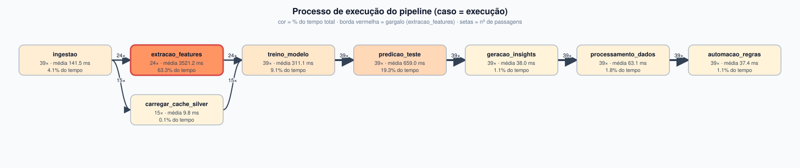
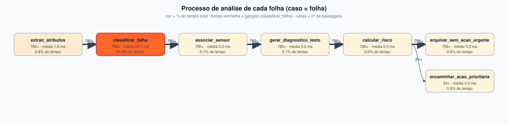

# Análise de processo (mineração de processos)

Gerado por `analise_processo.py` a partir de 39 execuções do pipeline (273 eventos de etapa) e 780 casos de folha (4680 eventos).

## 1. Processo de execução do pipeline

### Métricas por atividade

| atividade | ocorrencias | media_s | mediana_s | p95_s | total_s | pct_do_tempo_total | erros |
|---|---|---|---|---|---|---|---|
| extracao_features | 24 | 3.521 | 3.468 | 4.501 | 84.51 | 63.3 | 0 |
| predicao_teste | 39 | 0.659 | 0.572 | 1.125 | 25.7 | 19.3 | 0 |
| treino_modelo | 39 | 0.311 | 0.296 | 0.465 | 12.131 | 9.1 | 0 |
| ingestao | 39 | 0.141 | 0.069 | 0.445 | 5.517 | 4.1 | 0 |
| processamento_dados | 39 | 0.063 | 0.06 | 0.099 | 2.459 | 1.8 | 0 |
| geracao_insights | 39 | 0.038 | 0.017 | 0.145 | 1.482 | 1.1 | 0 |
| automacao_regras | 39 | 0.037 | 0.029 | 0.081 | 1.457 | 1.1 | 0 |
| carregar_cache_silver | 15 | 0.01 | 0.009 | 0.014 | 0.147 | 0.1 | 0 |

### Variantes (caminhos distintos)

| variante | casos | duracao_media_s | pct_dos_casos |
|---|---|---|---|
| ingestao > extracao_features > treino_modelo > predicao_teste > geracao_insights > processamento_dados > automacao_regras | 24 | 4.769 | 61.5 |
| ingestao > carregar_cache_silver > treino_modelo > predicao_teste > geracao_insights > processamento_dados > automacao_regras | 15 | 1.32 | 38.5 |

### Duração total por modo de execução

| modo | count | mean | median |
|---|---|---|---|
| cache_silver | 15 | 1.32 | 1.241 |
| completo | 24 | 4.769 | 4.702 |

## 2. Processo de análise de cada folha

| atividade | ocorrencias | media_s | mediana_s | p95_s | total_s | pct_do_tempo_total | erros |
|---|---|---|---|---|---|---|---|
| classificar_folha | 780 | 0.029 | 0.023 | 0.053 | 22.702 | 94.0 | 0 |
| extrair_atributos | 780 | 0.002 | 0.002 | 0.003 | 1.411 | 5.8 | 0 |
| gerar_diagnostico_texto | 780 | 0.0 | 0.0 | 0.0 | 0.028 | 0.1 | 0 |
| associar_sensor | 780 | 0.0 | 0.0 | 0.0 | 0.017 | 0.1 | 0 |
| calcular_risco | 780 | 0.0 | 0.0 | 0.0 | 0.006 | 0.0 | 0 |
| arquivar_sem_acao_urgente | 756 | 0.0 | 0.0 | 0.0 | 0.0 | 0.0 | 0 |
| encaminhar_acao_prioritaria | 24 | 0.0 | 0.0 | 0.0 | 0.0 | 0.0 | 0 |

### Variantes

| variante | casos | duracao_media_s | pct_dos_casos |
|---|---|---|---|
| extrair_atributos > classificar_folha > associar_sensor > gerar_diagnostico_texto > calcular_risco > arquivar_sem_acao_urgente | 756 | 0.462 | 96.9 |
| extrair_atributos > classificar_folha > associar_sensor > gerar_diagnostico_texto > calcular_risco > encaminhar_acao_prioritaria | 24 | 0.566 | 3.1 |

## 3. Insights

- **Gargalo na execução:** `extracao_features` concentra 63.3% do tempo acumulado das etapas.
- **Variação por modo:** a execução completa leva 4.77 s em média e a com cache Silver 1.32 s (3.6× mais rápida); o cache elimina a releitura das imagens de treino.
- **Gargalo por folha:** `classificar_folha` é o passo mais lento (29.1 ms em média, 94.0% do tempo), contra 0 µs do mais rápido.
- **Desfecho das folhas:** 3% das folhas seguem para ação prioritária e 97% são arquivadas sem ação urgente.
- **Retrabalho de dados:** 4.2% das associações folha-sensor caíram em leitura anômala (corrigida na preparação).
- **Esperas entre etapas:** mediana de 1.0 ms entre o fim de uma etapa e o início da seguinte; o tempo é gasto executando, não esperando.
- **Falhas registradas:** 0 eventos com resultado `erro`.

## 4. Oportunidades de melhoria

As recomendações abaixo derivam dos números acima; as aplicadas aparecem na seção seguinte.

1. **Predição por folha:** `classificar_folha` é o passo dominante por folha. O modelo roda com `n_jobs=-1` mesmo para uma amostra por vez, e o custo de criar threads supera o da inferência. Fixar `n_jobs=1` na predição ou predizer em lote.
2. **Extração de atributos de treino:** quando não há cache, `extracao_features` domina a execução. Manter o cache Silver incremental (só extrair imagens novas) ou paralelizar por processo.
3. **Dados de sensor:** a taxa de leituras anômalas é uma métrica de qualidade da fonte; acompanhar no painel de saúde e alertar quando passar de um limiar.

## 5. Antes e depois da melhoria aplicada

Cada linha é uma versão do pipeline (`VERSAO_PIPELINE`); as métricas vêm dos mesmos event logs.

| versao | execucoes | classificar_folha_ms | predicao_teste_s | duracao_cache_silver | duracao_completo |
|---|---|---|---|---|---|
| 1.0 | 19 | 46.491 | 1.007 | 1.735 | 4.861 |
| 1.1 | 20 | 12.589 | 0.328 | 0.857 | 4.696 |

`classificar_folha` caiu de 46.5 ms para 12.6 ms por folha (3.7× mais rápido) e a etapa `predicao_teste` de 1.01 s para 0.33 s.

No modo com cache Silver a execução passou de 1.74 s para 0.86 s. No modo completo foi de 4.86 s para 4.70 s: não houve ganho relevante, porque a extração de atributos das imagens de treino domina a execução completa (ver seção 3); a melhoria atacou outro gargalo.
