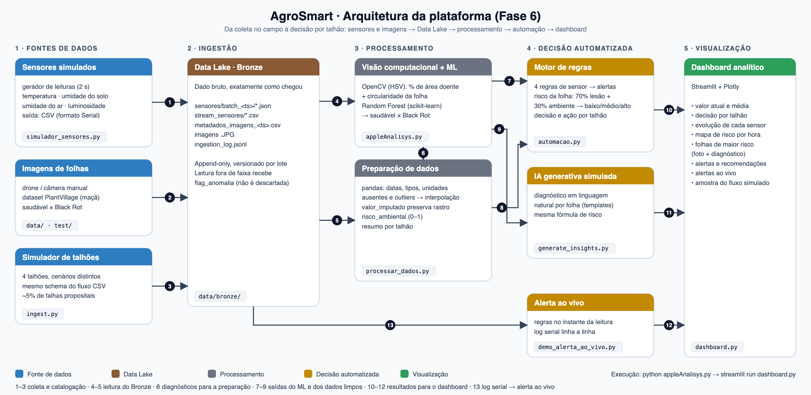

# Entrega 1 — Arquitetura da solução AgroSmart (Fase 6)

> **AgroSmart — Fase 6** · Turma ESOA4 · Cayo Gonçalves de Morais Malara (RM 551243) · Igor Nunes Teixeira (RM 551099) · Lorenzo Guimarães (RM 99621) · Thiago Bullara Leite (RM 99461)



Arquivos: [`arquitetura_fase6.png`](arquitetura_fase6.png) · [`arquitetura_fase6.svg`](arquitetura_fase6.svg) (gerado por `gerar_arquitetura.py`)

## Fluxo em uma frase

Sensores e fotos de folhas entram no Data Lake (Bronze), são limpos e transformados em atributos e modelos (Silver), viram alertas, riscos e decisões (Gold) e são apresentados em um dashboard.

## Componentes

| # | Componente | Tecnologia | Entradas | Saídas | Função |
|---|---|---|---|---|---|
| 1 | **Sensores simulados** (`simulacao/simulador_sensores.py`) | Python | Cenário de seca e umidade crescente | `data/bronze/stream_sensores/stream_simulado.csv` (formato Serial) | Fluxo contínuo de leituras (2 s) |
| 2 | **Simulador de talhões** (`ingest.py`) | Python | Cenários por talhão; lista de imagens | `data/bronze/sensores/batch_*/sensor_T*.json`, `metadados_imagens_*.csv`, `ingestion_log.jsonl` | Volume de dados por talhão, com falhas propositais |
| 3 | **Data Lake – Bronze** (`data/bronze/`) | Arquivos JSON/CSV, lotes append-only | Saídas do ingest e logs da Serial | Dado bruto + `flag_anomalia` | Preservar o dado como chegou |
| 4 | **Visão computacional + ML** (`appleAnalisys.py`) | OpenCV (HSV), scikit-learn (Random Forest) | Imagens `.JPG`, metadados | `data/silver/features_*.csv`, `data/gold/results.json` | Mede % de área doente e classifica saudável × Black Rot |
| 5 | **Preparação de dados** (`processar_dados.py`) | pandas | Sensores Bronze, `results.json`, fluxo simulado | `data/silver/sensores_limpos.csv`, `sensores_stream.csv`; `data/gold/dataset_dashboard.csv`, `diagnosticos.csv`, `resumo_talhoes.csv` | Limpeza, tipagem, interpolação, `risco_ambiental` |
| 6 | **Motor de regras** (`automacao.py`) | Python/pandas | `dataset_dashboard.csv`, `diagnosticos.csv` | `alertas.json/csv`, `risco_folhas.csv`, `acoes_talhao.json` | Alertas, classificação baixo/médio/alto e decisão por talhão |
| 7 | **Alerta ao vivo** (`demo_alerta_ao_vivo.py`) | Python | Fluxo Serial linha a linha | Console + `data/gold/alertas_ao_vivo.jsonl` | Mesmas regras, disparadas no instante da leitura |
| 8 | **IA generativa simulada** (`generate_insights.py`) | Python (templates) | `results.json` com contexto de sensor | `insights.json`, `exemplos_ia_generativa.md` | Diagnóstico em linguagem natural por folha |
| 9 | **Dashboard** (`dashboard.py`) | Streamlit + Plotly | Camada Gold, `sensores_stream.csv`, `alertas_ao_vivo.jsonl` | Interface web | Indicadores, séries, risco, folhas, alertas |

## Integração com as fases anteriores

| Componente | Origem | Integrado ao fluxo da Fase 6? |
|---|---|---|
| Data Lake Bronze/Silver/Gold, ingestão versionada | Fase 5 | Sim (base de tudo) |
| Extração de features e Random Forest | Fase 5 | Sim (alimenta risco da folha) |
| IA generativa simulada | Fase 5 | Sim (texto no dashboard; mesma fórmula de risco) |
| Modelagem do problema, coleta/organização, automação por regras e simulação de sensores das Fases 1–4 | Fases anteriores | **Não verificável:** os artefatos dessas fases não estão neste repositório; confirmar com a equipe e listar aqui |
| Sensores simulados, processamento, motor de regras, dashboard, alerta ao vivo | Fase 6 | Sim |

## Camadas de dados

- **Bronze:** o dado exatamente como chegou.
- **Silver:** dado limpo e estruturado (`features_*.csv`, `sensores_limpos.csv`, `validation_log.txt`).
- **Gold:** dado pronto para decisão e visualização (`data/gold/`).

## Execução

```bash
pip install -r requirements.txt
python appleAnalisys.py      # ingestão -> ML -> processamento -> automação
streamlit run dashboard.py   # dashboard em http://localhost:8501
```

`python appleAnalisys.py --usar-cache-silver` reaproveita as features de treino já extraídas, sem reler as ~2.000 imagens.

## Decisões de projeto

- **Integração por arquivos na camada Gold:** cada estágio lê a saída do anterior, então qualquer etapa pode ser rodada, testada e demonstrada isoladamente.
- **Mesma fórmula de risco em todo lugar:** texto gerado, classificação da folha e dashboard usam `_risco_ambiental`, então não há divergência entre o que o sistema diz e o que o gráfico mostra.
- **Anomalia não é descartada:** a leitura inválida é corrigida e continua rastreável, porque falha de sensor é informação para a equipe de campo.
