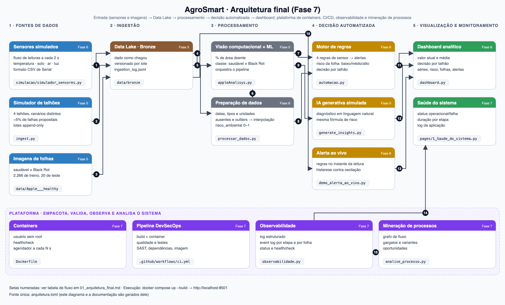

# Arquitetura final da solução AgroSmart

> Turma ESOA4 · Cayo Gonçalves de Morais Malara (RM 551243) · Igor Nunes Teixeira (RM 551099) · Lorenzo Guimarães (RM 99621) · Thiago Bullara Leite (RM 99461)

Gerado de `arquitetura.toml` por `docs_fase7/gerar_arquitetura_final.py` (fonte: `9bcdb3d31954`). Não edite este arquivo à mão.

## Componentes

| Camada | Componente | Arquivos | Tecnologia | Entradas | Saídas | Fase |
|---|---|---|---|---|---|---|
| Fonte de dados | **Sensores simulados** | `simulacao/simulador_sensores.py` | Python | cenário de seca e umidade crescente | data/bronze/stream_sensores/stream_simulado.csv | 6 |
| Fonte de dados | **Simulador de talhões** | `ingest.py` | Python | cenários por talhão, lista de imagens | data/bronze/sensores/batch_*/ e metadados_imagens_*.csv | 5 |
| Fonte de dados | **Imagens de folhas** | `data/Apple___healthy` `data/Apple___Black_rot` `test` | Dataset PlantVillage (maçã) | fotos de drone ou câmera | imagens .JPG | 5 |
| Ingestão | **Data Lake · Bronze** | `data/bronze` | Arquivos JSON/CSV | saídas dos simuladores | dado bruto + flag_anomalia | 5 |
| Processamento | **Visão computacional + ML** | `appleAnalisys.py` | OpenCV, scikit-learn (Random Forest) | imagens, metadados, sensores do Bronze | data/silver/features_*.csv, data/gold/results.json | 5 |
| Processamento | **Preparação de dados** | `processar_dados.py` | pandas | sensores Bronze, results.json, fluxo simulado | data/silver/sensores_*.csv, data/gold/dataset_dashboard.csv, diagnosticos.csv | 6 |
| Decisão automatizada | **Motor de regras** | `automacao.py` | Python, pandas | dataset_dashboard.csv, diagnosticos.csv | alertas.json/csv, risco_folhas.csv, acoes_talhao.json | 6 |
| Decisão automatizada | **IA generativa simulada** | `generate_insights.py` | Python (templates) | results.json com contexto de sensor | data/gold/insights.json | 5 |
| Decisão automatizada | **Alerta ao vivo** | `demo_alerta_ao_vivo.py` | Python | fluxo Serial linha a linha | console e data/gold/alertas_ao_vivo.jsonl | 6 |
| Visualização e monitoramento | **Dashboard analítico** | `dashboard.py` | Streamlit, Plotly | camada Gold, alertas ao vivo, fluxo simulado | interface web (porta 8501) | 6 |
| Visualização e monitoramento | **Saúde do sistema** | `pages/1_Saude_do_sistema.py` | Streamlit, Plotly | data/logs/execucoes.jsonl e app.log | painel de status, histórico e log | 7 |
| Plataforma | **Containers** | `Dockerfile` `docker-compose.yml` `.dockerignore` `requirements.txt` | Docker, Docker Compose | código e dados montados como volume | serviços pipeline, dashboard, scheduler | 7 |
| Plataforma | **Pipeline DevSecOps** | `.github/workflows/ci.yml` `scripts/ci_local.sh` `tests` `pyproject.toml` `requirements-dev.txt` | GitHub Actions, ruff, pytest, bandit, pip-audit, trivy | código-fonte | relatórios e imagem validada | 7 |
| Plataforma | **Observabilidade** | `observabilidade.py` `scripts/status.py` | Python (logs JSON, CSV) | eventos de cada etapa e de cada folha | data/logs/ (app.log, execucoes.jsonl, event_log_*.csv) | 7 |
| Plataforma | **Mineração de processos** | `analise_processo.py` | pandas, SVG | data/logs/event_log_*.csv | data/analise/ (DFG, métricas, variantes, relatório) | 7 |

## Fluxo de dados (setas do diagrama)

| # | De | Para |
|---|---|---|
| 1 | Sensores simulados | Data Lake · Bronze |
| 2 | Simulador de talhões | Data Lake · Bronze |
| 3 | Imagens de folhas | Data Lake · Bronze |
| 4 | Data Lake · Bronze | Visão computacional + ML |
| 5 | Data Lake · Bronze | Preparação de dados |
| 6 | Visão computacional + ML | Preparação de dados |
| 7 | Visão computacional + ML | Motor de regras |
| 8 | Preparação de dados | Motor de regras |
| 9 | Visão computacional + ML | IA generativa simulada |
| 10 | Data Lake · Bronze | Alerta ao vivo |
| 11 | Motor de regras | Dashboard analítico |
| 12 | IA generativa simulada | Dashboard analítico |
| 13 | Alerta ao vivo | Dashboard analítico |
| 14 | Observabilidade | Saúde do sistema |
| 15 | Observabilidade | Mineração de processos |

### Em palavras

1. **Entrada.** Sensores simulados (fluxo CSV a cada 2 s) e o simulador de talhões (lotes horários com falhas propositais) gravam no Data Lake **Bronze**, junto com as imagens de folhas catalogadas por talhão.
2. **Processamento.** A visão computacional mede a área doente e o Random Forest classifica a folha; a preparação limpa os sensores (datas, tipos, ausentes e outliers) e calcula o risco ambiental. Resultados vão para **Silver** e **Gold**.
3. **Decisão.** O motor de regras gera alertas de sensor, classifica o risco de cada folha e decide a ação por talhão; a IA generativa simulada escreve o diagnóstico; o alerta ao vivo aplica as mesmas regras a cada leitura.
4. **Saída.** O dashboard mostra indicadores, séries, risco, folhas e alertas; a página *Saúde do sistema* mostra o estado do pipeline.
5. **Plataforma.** Tudo roda em containers; o pipeline DevSecOps valida cada mudança; a observabilidade registra logs e o event log, que a análise de processo transforma em gargalos, variantes e melhorias.
