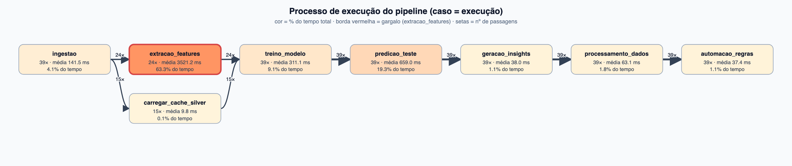
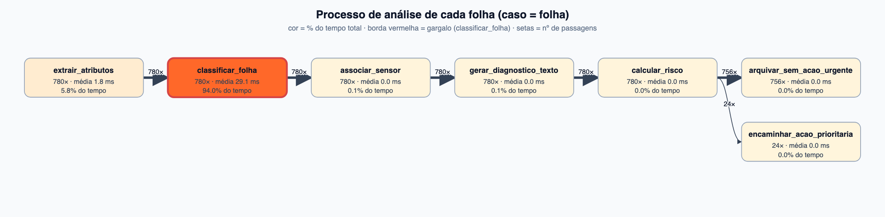

# Análise de processo (Fase 7 · requisito 5)

> Turma ESOA4 · Cayo Gonçalves de Morais Malara (RM 551243) · Igor Nunes Teixeira (RM 551099) · Lorenzo Guimarães (RM 99621) · Thiago Bullara Leite (RM 99461)

## Para que serve a mineração de processos aqui
Mineração de processos pega o **registro real de eventos** de um sistema (quem fez o quê, quando e quanto tempo levou) e reconstrói o processo como ele **de fato acontece**, em vez de como foi desenhado. No AgroSmart ela responde três perguntas com dados do próprio sistema: onde o tempo é gasto (**gargalos**), por quais caminhos diferentes os casos passam (**variações**) e o que vale melhorar (**oportunidades**). Ela também fecha o ciclo da fase: o pipeline gera o event log, a análise acha um gargalo, a melhoria é aplicada e o log seguinte mostra o ganho.

## Event log
O pipeline grava dois event logs (`observabilidade.py`), com colunas no formato padrão de mineração de processos (`case_id`, `atividade`, `inicio`, `fim`, `duracao_s`, `recurso`, `resultado`):

| Log | Caso | Atividades |
|---|---|---|
| `data/logs/event_log_execucoes.csv` | uma execução do pipeline | ingestao, extracao_features (ou carregar_cache_silver), treino_modelo, predicao_teste, geracao_insights, processamento_dados, automacao_regras |
| `data/logs/event_log_folhas.csv` | uma folha analisada em uma execução | extrair_atributos, classificar_folha, associar_sensor, gerar_diagnostico_texto, calcular_risco, e o desfecho (encaminhar_acao_prioritaria ou arquivar_sem_acao_urgente) |

Exemplo (`entrega/fase7/5_processo_e_video_final/event_log_amostra/`):

```csv
case_id,atividade,inicio,fim,duracao_s,recurso,resultado,registros
20261021T183237-7d20,ingestao,2026-10-21T18:32:37.77,...,0.09,ingest.py,ok,160
20261021T183237-7d20,extracao_features,...,2.19,appleAnalisys.py,ok,2266
20261021T183237-7d20:applehealthy10.JPG,classificar_folha,...,0.052,appleAnalisys.py,Apple___healthy
```

Base analisada: **39 execuções** (780 folhas, 4.680 eventos de folha), geradas pelo agendador do `docker-compose`, que roda o pipeline com dados novos a cada ciclo. Duas execuções inválidas foram excluídas de forma documentada (`data/logs/runs_excluidas.txt`).

## Representação do processo

**Execução do pipeline** (`analise/dfg_execucoes.png`): fluxo linear com uma bifurcação, extrair as features das imagens ou carregar o cache Silver.



**Análise de cada folha** (`analise/dfg_folhas.png`): fluxo linear com um desvio no final.



Cor = parcela do tempo total; borda vermelha = gargalo; número nas setas = quantas vezes o caminho foi percorrido. Gerados por `analise_processo.py` direto do log.

## Análise

### Gargalos
| Nível | Gargalo | Evidência |
|---|---|---|
| Execução | `extracao_features` | 63,3% do tempo acumulado das etapas (média 3,5 s por execução completa) |
| Execução (2º) | `predicao_teste` | 19,3% do tempo |
| Folha | `classificar_folha` | 94,0% do tempo por folha (29 ms em média, contra 1,8 ms do passo seguinte e microssegundos dos demais) |

### Variações (variantes)
| Variante | Casos | Duração média |
|---|---|---|
| Execução com extração das imagens | 24 | 4,8 s |
| Execução com cache Silver | 15 | 1,3 s (**3,6× mais rápida**) |
| Folha arquivada sem ação urgente | 756 (97%) | 0,46 s |
| Folha encaminhada para ação prioritária | 24 (3%) | 0,57 s |

Outras variações: 4,2% das associações folha-sensor caem em leitura anômala (corrigida na preparação). Foram registrados **0 eventos com erro**: nesta base não houve execução com falha.

### Esperas
A mediana entre o fim de uma etapa e o início da seguinte é de 1 ms: o tempo é gasto **executando**, não esperando. Não há gargalo de fila ou de integração entre etapas.

## Oportunidades de melhoria e o que foi feito

| # | Oportunidade | Estado |
|---|---|---|
| 1 | **Predição por folha.** O modelo rodava com `n_jobs=-1` mesmo para uma amostra por vez, e criar o pool de threads custava mais que a inferência | **Aplicada (versão 1.1)**: `n_jobs=1` depois do treino |
| 2 | **Extração de atributos de treino** domina a execução completa | Mitigada pelo cache Silver (já existente); proposta: cache incremental ou extração em paralelo por processo |
| 3 | **Qualidade da fonte de dados:** acompanhar a taxa de leituras anômalas | Indicador já exposto na página *Saúde do sistema*; falta alertar por limiar |

### Antes e depois (mesmos event logs, versões 1.0 e 1.1)
| Versão | Execuções | `classificar_folha` por folha | `predicao_teste` | Execução com cache | Execução completa |
|---|---|---|---|---|---|
| 1.0 | 19 | 46,5 ms | 1,01 s | 1,74 s | 4,86 s |
| 1.1 | 20 | **12,6 ms** | **0,33 s** | **0,86 s** | 4,70 s |

A predição por folha ficou **3,7× mais rápida** e a execução com cache caiu pela metade. A execução **completa não melhorou de forma relevante**, como esperado: o gargalo dela é a extração das imagens, que a melhoria não toca.

## Limitações
- Os dados e os cenários são **simulados**; os tempos refletem esta máquina e um dataset de 2.286 imagens.
- Sem execuções com falha, a análise não mostra caminhos de erro; o log já está pronto para registrá-los (`resultado = erro`).
- A mineração foi feita com `pandas` e um desenhista de grafo próprio (`analise_processo.py`), sem a biblioteca `pm4py`; o formato do event log é compatível com ela.

## Como reproduzir
```bash
docker compose --profile continuo up -d     # gera execuções (INTERVALO_SEGUNDOS=20 para acelerar)
python analise_processo.py                  # gera data/analise/ (DFG, métricas, variantes, relatório)
```

## Evidências
`entrega/fase7/5_processo_e_video_final/`: `analise/` (diagramas, métricas, variantes, relatório) e `event_log_amostra/`.
